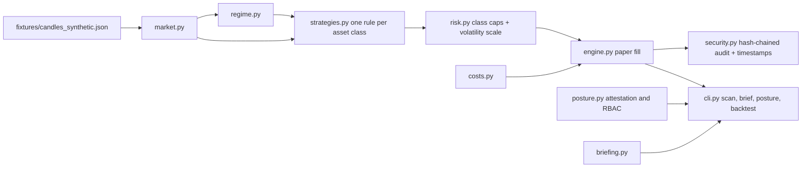

# Architecture

Runtime dependencies are the Python standard library. Tests inject fetchers
and never open a socket. See [security-architecture.md](security-architecture.md)
and [asset-class-strategies.md](asset-class-strategies.md).

Version 0.3 adds ATR-based size scaling in the risk gate and UTC timestamps
inside the hashed audit detail. Paper-only constraints are unchanged.
